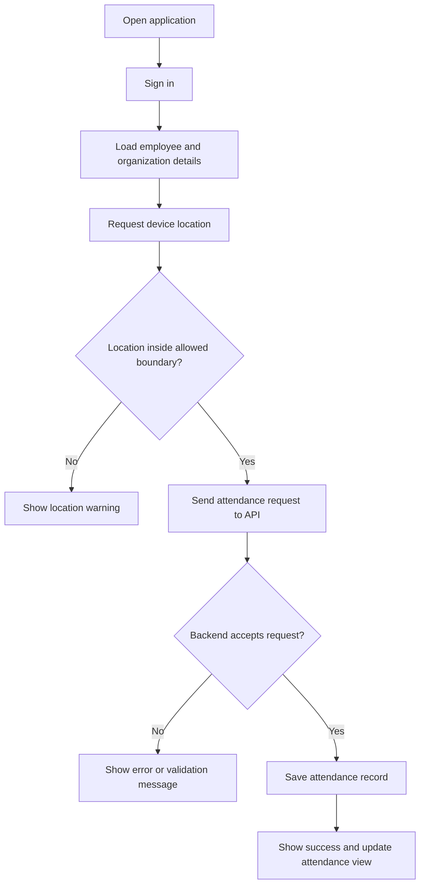
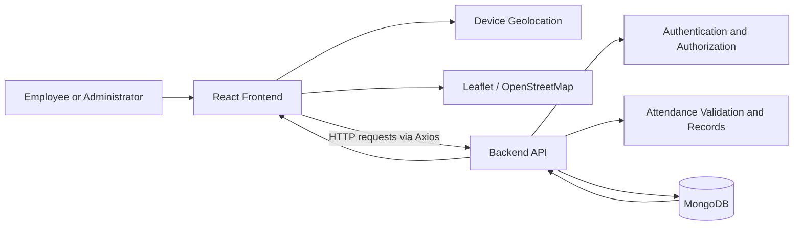

# Presence Pulse — Employee Attendance Management System

<p align="center">
  <strong>Location-aware employee attendance, punch-in/punch-out tracking, and attendance history.</strong>
</p>

<p align="center">
  <a href="https://github.com/Justakap/empAttFront">
    
  </a>
  
  
  
</p>
**Presence Pulse** (also referred to as *Mark Presence Pulse*) is an employee attendance management application designed to make attendance recording more reliable and easier to review. It supports location-aware punch-in workflows, employee profiles, attendance history, and administrative monitoring.

This repository contains the **React frontend** for the application. The complete solution also relies on a backend API and a database for authentication, attendance records, and organization-related data.

> **Project scope:** This README describes the project based on the frontend repository and the project presentation. Exact API behavior and available features can depend on the deployed backend and configuration.

## Contents

- [Overview](#overview)
- [Why Presence Pulse](#why-presence-pulse)
- [Key Features](#key-features)
- [How It Works](#how-it-works)
- [Geofencing and Location Validation](#geofencing-and-location-validation)
- [Technology Stack](#technology-stack)
- [Architecture](#architecture)
- [Getting Started](#getting-started)
- [Environment Configuration](#environment-configuration)
- [Available Scripts](#available-scripts)
- [Deployment](#deployment)
- [Testing Considerations](#testing-considerations)
- [Security and Privacy Notes](#security-and-privacy-notes)
- [Future Improvements](#future-improvements)
- [Contributing](#contributing)
- [License](#license)

## Overview

Traditional attendance systems can rely on manual registers or records that are difficult to verify and analyze. Presence Pulse aims to digitize this process by recording punch events and associating them with employee and location information.

The application is designed around three main goals:

1. **Reliable attendance records** — record punch-in and punch-out timestamps.
2. **Location-aware attendance** — check whether an employee is within an organization-defined geographic area before accepting a punch.
3. **Visibility and reporting** — let authorized staff review attendance records, employee activity, and work-hour information.

## Why Presence Pulse

- Reduces dependence on manual attendance registers.
- Provides a consistent digital record of employee attendance.
- Uses geographic boundaries as an additional check during attendance marking.
- Makes attendance history easier for employees and administrators to access.
- Establishes a foundation for attendance summaries, irregular-punch review, and reporting.

## Key Features

### Employee experience

- **Authentication:** role-specific login flows for the supported user types.
- **Employee profile:** view available profile and organization information.
- **Punch-in / punch-out workflow:** submit attendance events through the application.
- **Location-aware attendance:** use device geolocation and a defined allowed area as part of the punch workflow.
- **Attendance history:** review recorded attendance entries where enabled by the backend.
- **User feedback:** display success or error messages for common outcomes and API failures.

### Organization and administration

- **Organization-aware records:** attendance requests include employee and organization context.
- **Attendance monitoring:** authorized administrators can review employee attendance records.
- **Boundary configuration:** organization boundaries can be defined for location-based validation.
- **Attendance review:** support for checking punch times and work-hour totals, depending on backend capabilities.
- **Exception handling:** the intended workflow includes handling invalid locations, duplicate or early punches, and missed or irregular attendance events.

> Features such as notifications, manual attendance adjustments, total-hours calculation, and specific admin dashboards should be confirmed against the backend implementation before being treated as available in every deployment.

## How It Works

A typical attendance flow is:

1. **Sign in** — the user chooses the relevant login flow and submits their credentials.
2. **Load user context** — the application receives the authenticated user information and authorization data from the API.
3. **Open the punch screen** — the user starts the attendance action.
4. **Get device location** — the browser/device requests permission to access the current geographic coordinates.
5. **Validate the location** — the frontend uses geographic boundary data to check whether the coordinates fall inside the allowed area.
6. **Submit the attendance event** — if the frontend validation passes, the application sends the employee, organization, coordinates, and timestamp-related information to the backend.
7. **Persist and respond** — the backend is responsible for validating the request and saving the attendance record. The UI displays the result.
8. **Review attendance** — users and authorized administrators can review the attendance information made available to their role.

### High-level workflow



## Geofencing and Location Validation

Location validation is a key part of the attendance workflow.

The frontend dependencies include **Leaflet**, **React Leaflet**, and **Turf.js**. Turf.js can perform geographic calculations, including point-in-polygon checks. The intended flow is to represent the organization's allowed area as a polygon and compare the employee's coordinates with that polygon.

Conceptually:

- The organization defines a permitted geographic boundary.
- The device provides latitude and longitude after the user grants location permission.
- The application constructs a geographic point from those coordinates.
- The point is checked against the allowed polygon.
- If the point is outside the boundary, the frontend can stop the workflow and show a warning.
- If the point passes, the attendance request is sent to the backend.

**Important:** client-side geofencing improves the user experience but must not be the only security control. The backend should independently validate the permitted boundary, user identity, organization membership, attendance state, and timestamp. Device location can be inaccurate or spoofed, so location checks should be treated as one signal rather than absolute proof of physical presence.

## Technology Stack

| Technology | Purpose |
|---|---|
| React 18 | Component-based frontend UI |
| React Router | Client-side navigation |
| Axios | HTTP requests to the backend API |
| Leaflet | Interactive maps |
| React Leaflet | React bindings for Leaflet maps |
| Turf.js | Geographic operations, including point-in-polygon validation |
| OpenStreetMap | Map data used by the map interface |
| React Toastify | User-facing success and error notifications |
| Heroicons | UI icons |
| Flowbite / Tailwind CSS configuration | Styling and UI utilities |
| Node.js and Express | Backend API, as described in the project documentation |
| MongoDB | Application data storage, as described in the project documentation |

The React frontend dependencies are listed in [`package.json`](./package.json). Node.js, Express, and MongoDB are the backend technologies described in the project presentation.

## Architecture

The application follows a frontend/API/database architecture.



### Frontend responsibilities

- Render login, profile, punch, and attendance interfaces.
- Request location permission and display map/location information.
- Perform client-side geographic checks where configured.
- Send requests to backend endpoints.
- Present API responses and validation errors to the user.

### Backend responsibilities

The backend is responsible for the authoritative business rules and persistent data, including:

- Authenticating users and enforcing role-based access.
- Validating employee and organization context.
- Validating attendance state and permitted working times.
- Rechecking location restrictions on the server where applicable.
- Persisting punch-in and punch-out events.
- Providing attendance records for authorized views and reports.

The precise routes, schemas, and implementation details should be documented from the backend source code rather than inferred from the frontend.

## Getting Started

### Prerequisites

Install the following before running the frontend:

- [Node.js](https://nodejs.org/) and npm
- Git
- Access to a compatible backend API, unless you are only working on UI components

### 1. Clone the repository

```bash
git clone https://github.com/Justakap/empAttFront.git
cd empAttFront
```

### 2. Install dependencies

```bash
npm install
```

If you want a reproducible install from the committed lockfile, you can use:

```bash
npm ci
```

### 3. Configure the API URL

Create or update a `.env` file in the project root. See [Environment Configuration](#environment-configuration) below.

### 4. Start the development server

```bash
npm start
```

Create React App starts the development server, normally at:

[http://localhost:3000](http://localhost:3000)

The frontend may not be fully functional until the configured backend API is reachable and has the required data.

## Environment Configuration

The frontend uses Create React App environment variables. Variables exposed to the browser must use the `REACT_APP_` prefix.

Example local `.env`:

```env
REACT_APP_API_BASE_URL=http://localhost:8000
REACT_APP_API_OWN_URL=http://localhost:3000
```

- `REACT_APP_API_BASE_URL` — base URL used for backend API requests.
- `REACT_APP_API_OWN_URL` — application URL/configuration value used by the project.

**Use the actual API port and URL for your backend.** The values above are examples for local development; confirm the backend configuration before relying on them. Restart `npm start` after changing environment variables.

Do not commit secrets, access tokens, private keys, or credentials to Git. Keep local environment files out of version control and provide a sanitized `.env.example` when sharing configuration. Since Create React App variables are embedded into the client bundle, they must never contain secrets.

## Available Scripts

These scripts are defined by the project's `package.json`:

| Command | Description |
|---|---|
| `npm start` | Run the local development server |
| `npm test` | Run tests using the Create React App test runner |
| `npm run build` | Create an optimized production build in `build/` |
| `npm run eject` | Eject Create React App configuration; this is a one-way operation and is generally unnecessary |

## Deployment

The project presentation identifies the following deployment services:

- **Frontend:** Netlify
- **Backend:** Vercel
- **Database:** MongoDB Atlas
- **Application domain shown in the presentation:** `markpresencepulse.com`

Deployment settings may differ by environment, so confirm the current hosting configuration before deploying.

### Frontend deployment checklist

1. Push the frontend code to the connected Git repository.
2. Configure the build command as `npm run build`.
3. Set the publish/output directory to `build`.
4. Configure the production `REACT_APP_API_BASE_URL` to point to the deployed backend.
5. Configure the backend's allowed origins/CORS settings to include the frontend domain.
6. Verify login, geolocation permission, punch-in/punch-out, and attendance history on the deployed site.
7. Confirm that the production backend and database are not exposing credentials or unrestricted access.

For client-side routing, configure the hosting provider to serve `index.html` for application routes when required.

## Testing Considerations

The following cases are useful when validating the complete system:

- **Location:** inside the permitted boundary, outside it, and near polygon edges.
- **Permissions:** location permission granted, denied, or unavailable.
- **Punch-in:** successful request, duplicate request, invalid time, and API failure.
- **Punch-out:** valid punch-out, missing punch-in, and repeated punch-out.
- **Time calculations:** normal shifts and shifts crossing midnight.
- **Network handling:** timeout, offline state, and backend errors.
- **Authentication:** invalid credentials, expired/invalid authorization, and role restrictions.
- **Authorization:** employees must not be able to access another employee's private attendance data.
- **Administration:** verify that attendance review and any manual adjustments are restricted to authorized roles.

These are recommended validation scenarios; they are not a claim that automated tests for every case are already present.

## Security and Privacy Notes

Attendance data and location coordinates are sensitive operational information.

- Request location permission only when it is needed for the attendance action.
- Explain the purpose of location collection to users.
- Validate permissions and attendance rules on the backend; do not trust client-provided employee IDs, organization IDs, timestamps, or coordinates without verification.
- Use HTTPS in production.
- Keep credentials and database connection strings in server-side environment variables.
- Apply role-based access control to employee profiles and attendance records.
- Avoid logging precise location data or authentication tokens unnecessarily.
- Define suitable retention and access policies for attendance records.

## Future Improvements

Possible extensions for the project include:

- Attendance dashboards with daily, weekly, and monthly summaries.
- Exportable attendance reports.
- Clear handling of missed punches and correction requests.
- Notifications for irregular attendance, if supported by the business requirements.
- Stronger server-side geofence validation and audit logs.
- Automated tests for boundary cases, authentication, and attendance-state transitions.
- Improved accessibility, mobile responsiveness, and loading/error states.

## Contributing

Contributions and suggestions are welcome.

1. Fork the repository.
2. Create a feature branch: `git checkout -b feature/your-feature`.
3. Make and test your changes.
4. Commit your work: `git commit -m "Add your feature"`.
5. Push the branch and open a pull request.

For bugs or feature requests, open an issue in the [GitHub repository](https://github.com/Gupta-Kavya/itr_empatt).

## License

No license information was confirmed while preparing this README. Add a `LICENSE` file and update this section if you intend to distribute the project under a specific open-source license.

---

**Repository:** [Gupta-Kavya/itr_empatt](https://github.com/Gupta-Kavya/itr_empatt)  
**Project:** Presence Pulse — Employee Attendance Management System
